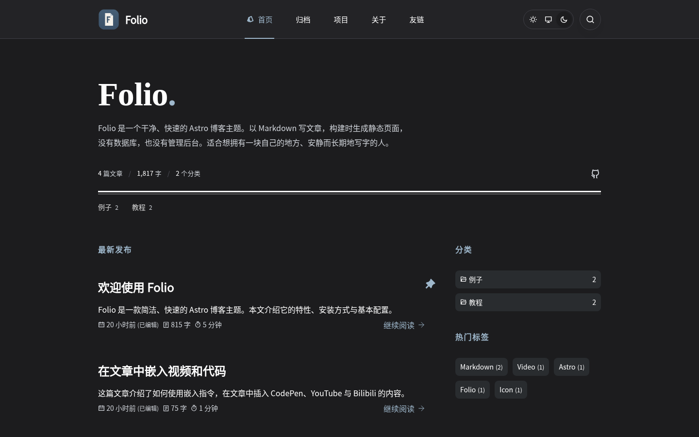

**English** | [简体中文](./README.zh-CN.md)

<div align="center">


# Folio

A clean, fast blog theme for Astro — rebuilt from [astro-gyoza](https://github.com/lxchapu/astro-gyoza) on the latest stack.

[](https://github.com/ethanmakes/astro-folio/releases)
[](./LICENSE)


[Live Demo](https://ethanmakes.github.io/astro-folio/) · [User Guide](https://ethanmakes.github.io/astro-folio/posts/guide/)

</div>

Folio is a thorough rebuild of astro-gyoza: the stack moves to Astro 7 + Tailwind CSS 4 with React removed entirely, and the visuals are redesigned — a full-width header bar, an editorial masthead, a single slate accent color, and a brand-new search panel. All of the original theme's small touches are kept.

| Light | Dark |
| :--: | :--: |
|  |  |

## 🎉 Features

- ✅ SEO-friendly, with canonical URLs and OpenGraph metadata
- ✅ Sitemap support
- ✅ RSS feed
- ✅ Dark mode
- ✅ Grayscale on memorial days
- ✅ Clean, simple color scheme
- ✅ Syntax highlighting
- ✅ Reading progress bar on post pages (tracks scrolling at the bottom edge of the header)
- ✅ One-click code copy (button label `copy` / `copied`, always visible on touch devices)
- ✅ Image lightbox for post images (click to zoom, with arrow and keyboard navigation)
- ✅ Post series: organize posts with `series` / `seriesOrder` frontmatter and get a series index at the end of each post
- ✅ Search panel: a centered dialog that follows the site palette and dark mode, with ↑↓ selection, Enter to open, and a Ctrl/⌘+K shortcut (pagefind)
- ✅ Single-point deploy URL: set `site.url` in `src/config.json` only — origin and subpath are split automatically at build time
- ✅ Pure Astro + vanilla JS, no React runtime; full TypeScript types (astro check passes with zero errors)

## 🔧 Tech Stack

- [Astro](https://astro.build/)
- [Tailwind CSS](https://tailwindcss.com/)
- [Pagefind](https://pagefind.app/)

## 🚀 Quick Start

```bash
git clone https://github.com/ethanmakes/astro-folio.git
cd astro-folio
pnpm i
pnpm dev
```

Site configuration lives in `src/config.json`. Start by setting `site.url` to your site's address — origin and subpath both go in this one place and are split automatically at build time. Posts live in `src/content/posts/`; frontmatter fields: `title`, `date`, `lastMod`, `summary`, `cover`, `category`, `tags`, `series`, `seriesOrder`, `comments`, `draft`, `sticky`.

## 📦 Deployment

A GitHub Pages workflow ships with the repo: set `site.url` in `src/config.json` to your Pages address, set the Pages Source to GitHub Actions under Settings → Pages, and every push to `main` will build and publish automatically. Vercel / Netlify and similar platforms work too: build command `pnpm build`, output directory `dist`.

## 🚀 Project Structure

```text
├── public/
├── src/
│   ├── components/
│   ├── content/
│   ├── layouts/
│   ├── pages/
│   ├── plugins/
│   ├── scripts/
│   ├── styles/
│   ├── utils/
│   └── config.json
├── astro.config.js
├── README.md
├── package.json
└── tsconfig.json
```

## 🧞 Commands

| Command        | Action                                       |
| :------------- | :------------------------------------------- |
| `pnpm i`       | Installs dependencies                        |
| `pnpm dev`     | Starts local dev server at `localhost:4321`  |
| `pnpm build`   | Build your production site to `./dist/` (includes astro check and the pagefind index) |
| `pnpm preview` | Preview your build locally, before deploying |
| `pnpm new-post` | Create a new post                           |

## 🔄 Differences from Upstream

- **Astro 4 → 7**, with content collections migrated to the Content Layer API (glob loader)
- **React removed entirely**: react / framer-motion / jotai / Radix are all gone — all 33 components were rewritten one by one as Astro components plus vanilla scripts and CSS, drastically reducing client-side JS
- **Tailwind CSS v3 → v4** (@tailwindcss/vite plugin, CSS-first configuration)
- Page transitions now use Astro's built-in View Transitions (@swup/astro removed)
- Toast is now a small hand-written implementation (react-toastify removed)
- The share QR code is generated statically at build time (qrcode.react removed)
- Waline comments removed (it requires a separately deployed server, which conflicts with the pure-static approach; the `comments` frontmatter field is kept, so zero-backend options such as giscus can be wired up later)
- `category` is now a first-class frontmatter field alongside `tags` (defaults to "Uncategorized" when omitted)

All of the original small features are kept: memorial-day grayscale, the 404 flashlight, the site running-days counter, total word count, archive year/today progress, stale-post notice, relative timestamps, pagefind full-text search, and dark mode.

## 🙏 Acknowledgements

Forked from [astro-gyoza](https://github.com/lxchapu/astro-gyoza) by [lxchapu](https://github.com/lxchapu); the design and original implementation belong to the original author, with thanks.

This theme was rebuilt and redesigned by Ethan together with Muse, his AI partner.

## 📄 License

[MIT](./LICENSE) — same as the upstream project. The original project's copyright belongs to lxchapu; see the LICENSE file for details.
