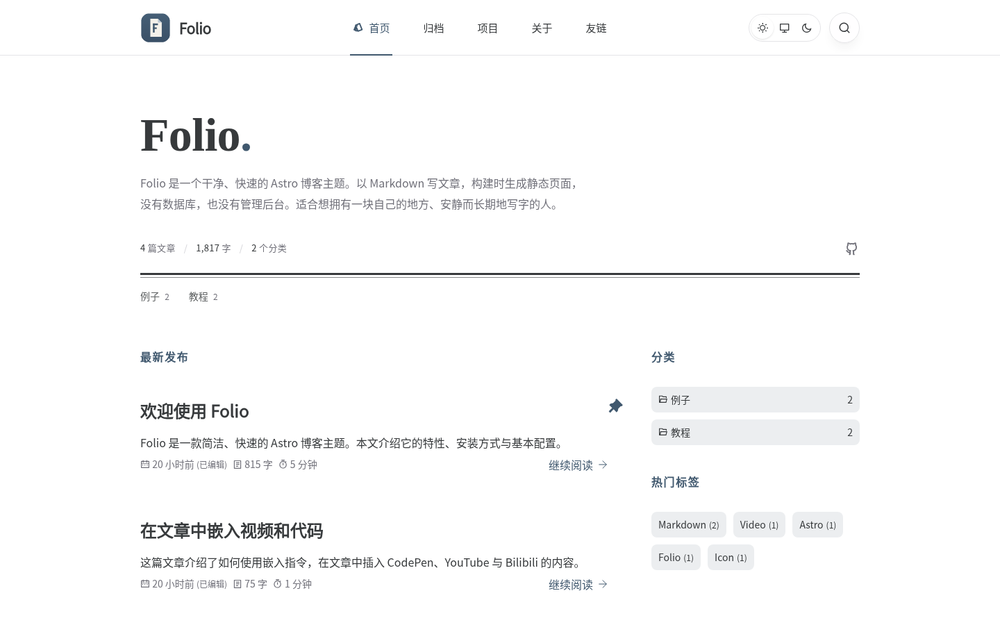
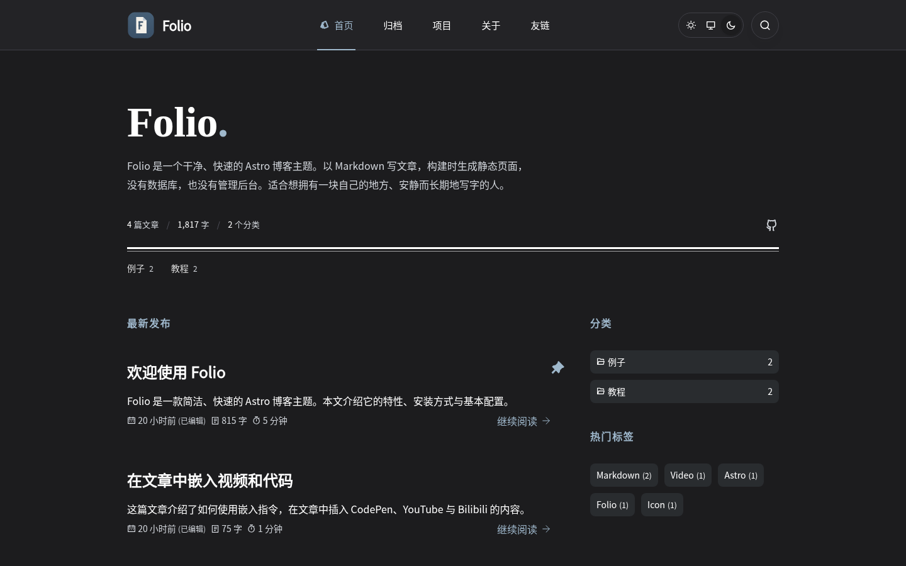

**简体中文** | [English](./README.md)

<div align="center">


# Folio

A clean, fast blog theme for Astro — rebuilt from [astro-gyoza](https://github.com/lxchapu/astro-gyoza) on the latest stack.

[](https://github.com/ethanmakes/astro-folio/releases)
[](./LICENSE)


[在线演示](https://ethanmakes.github.io/astro-folio/) · [使用指南](https://ethanmakes.github.io/astro-folio/posts/guide/)

</div>

astro-folio 是在 astro-gyoza 基础上的一次全面重构：技术栈升级到 Astro 7 + Tailwind CSS 4 并移除 React 整套依赖，视觉也重新设计——全宽导航栏、编辑刊头、单一蓝灰主题色与全新的搜索面板。原版的小功能全部保留。

| 浅色 | 深色 |
| :--: | :--: |
|  |  |

## 🎉 Features

- ✅ 有着规范的 URL 和 OpenGraph 信息，对 SEO 友好
- ✅ 支持站点地图
- ✅ 支持 RSS 订阅
- ✅ 支持夜间模式
- ✅ 特殊日期变灰
- ✅ 简单干净的配色和主题
- ✅ 支持代码高亮
- ✅ 文章页阅读进度条（顶栏底部随滚动推进）
- ✅ 代码块一键复制（按钮文案 copy / copied，触屏常显）
- ✅ 文章图片灯箱（点击放大，支持左右切换与键盘导航）
- ✅ 文章系列：frontmatter 用 `series` / `seriesOrder` 组织，文末自动生成系列目录
- ✅ 搜索面板：居中弹窗，跟随站点配色与夜间模式，支持 ↑↓ 选择、Enter 打开、Ctrl/⌘+K 唤起
- ✅ 部署地址单点配置：只改 `src/config.json` 的 `site.url`，域名与子路径由构建自动拆分
- ✅ 纯 Astro + 原生 JS，无 React 运行时；TypeScript 类型完备（astro check 零错误）
- ✅ Lighthouse 跑分：无障碍 100 · 最佳实践 100 · SEO 100（[在线 PageSpeed 检测](https://pagespeed.web.dev/analysis?url=https%3A%2F%2Fethanmakes.github.io%2Fastro-folio%2F)）

## 🔧 Tech Stack

- [Astro](https://astro.build/)
- [Tailwind CSS](https://tailwindcss.com/)
- [Pagefind](https://pagefind.app/)

## 🚀 快速开始

```bash
git clone https://github.com/ethanmakes/astro-folio.git
cd astro-folio
pnpm i
pnpm dev
```

网站配置保存在 `src/config.json` 文件：先把 `site.url` 改成你的站点地址（域名与子路径都写在这一个地方，构建时自动拆分）。文章放在 `src/content/posts/`，frontmatter 字段：`title`、`date`、`lastMod`、`summary`、`cover`、`category`、`tags`、`series`、`seriesOrder`、`comments`、`draft`、`sticky`。

## 📦 部署

仓库自带 GitHub Pages 工作流：把 `src/config.json` 的 `site.url` 改为你的 Pages 地址，在仓库 Settings → Pages 里将 Source 设为 GitHub Actions，之后每次推送到 `main` 分支都会自动构建并发布。也可以部署到 Vercel / Netlify 等平台：构建命令 `pnpm build`，输出目录 `dist`。

## 🚀 Project Structure

```text
├── public/
├── src/
│   ├── components/
│   ├── content/
│   ├── layouts/
│   ├── pages/
│   ├── plugins/
│   ├── scripts/
│   ├── styles/
│   ├── utils/
│   └── config.json
├── astro.config.js
├── README.md
├── package.json
└── tsconfig.json
```

## 🧞 Commands

| Command        | Action                                       |
| :------------- | :------------------------------------------- |
| `pnpm i`       | Installs dependencies                        |
| `pnpm dev`     | Starts local dev server at `localhost:4321`  |
| `pnpm build`   | Build your production site to `./dist/`（含 astro check 与 pagefind 索引） |
| `pnpm preview` | Preview your build locally, before deploying |
| `pnpm new-post` | Create a new post                           |

## 🔄 与原版的区别

- **Astro 4 → 7**，内容集合迁移到 Content Layer API（glob loader）
- **移除 React 整套**：react / framer-motion / jotai / Radix 全部下线，33 个组件逐项用 Astro 组件 + 原生脚本 / CSS 等价平替，客户端 JS 大幅瘦身
- **Tailwind CSS v3 → v4**（@tailwindcss/vite 插件，CSS 优先配置）
- 页面切换改用 Astro 内置 View Transitions（原 @swup/astro 移除）
- toast 改为自写轻量实现（原 react-toastify 移除）
- 分享二维码改为构建期静态生成（原 qrcode.react 移除）
- 移除 Waline 评论（需单独部署服务端，与纯静态方案冲突；文章 `comments` 字段保留，将来可接 giscus 等零后端方案）
- 文章 `category` 正式确立为一等字段，与 `tags` 并存（缺失时默认「未分类」）

原版小功能全部保留：特殊日期变灰、404 手电筒、运行天数、全站字数统计、归档页年度/今日进度、文章过期提示、相对时间显示、pagefind 全文搜索、夜间模式。

## 🙏 Acknowledgements

本项目 fork 自 [lxchapu](https://github.com/lxchapu) 的 [astro-gyoza](https://github.com/lxchapu/astro-gyoza)，设计与原始实现归原作者所有，特此致谢。

本主题由 Ethan 与 AI 搭子 Muse 共同重构与设计。

## 📄 License

[MIT](./LICENSE) — 与原项目保持一致。原项目版权归 lxchapu 所有，详见 LICENSE 文件。
